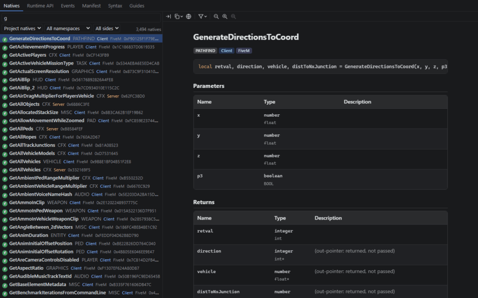
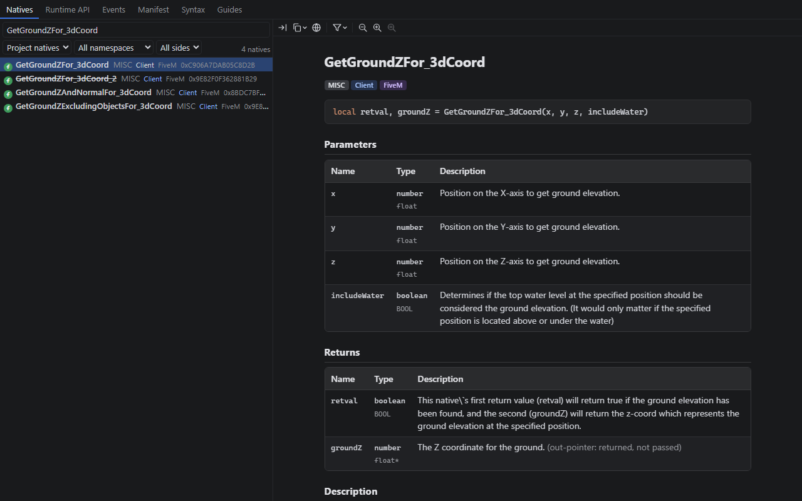
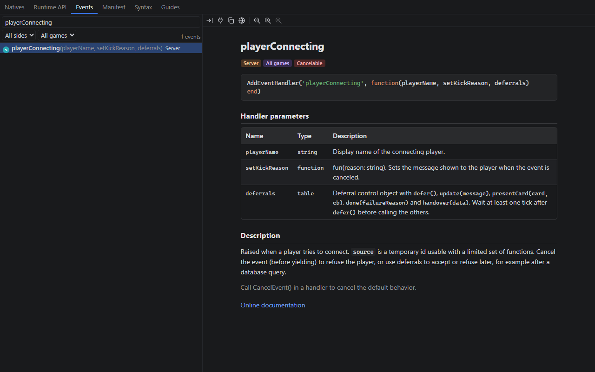
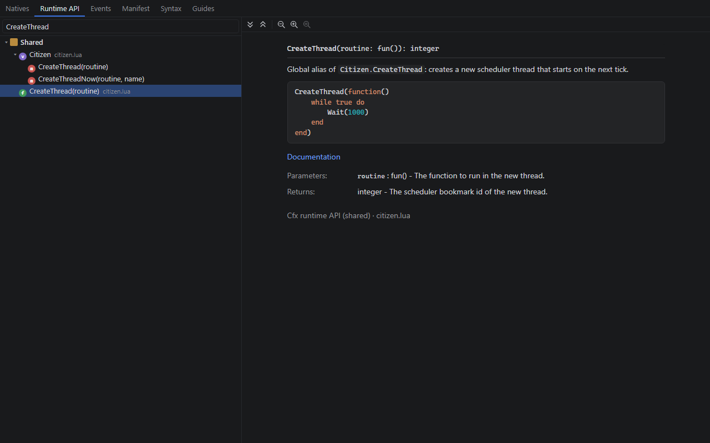
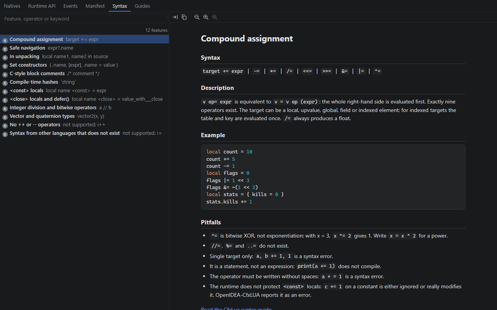
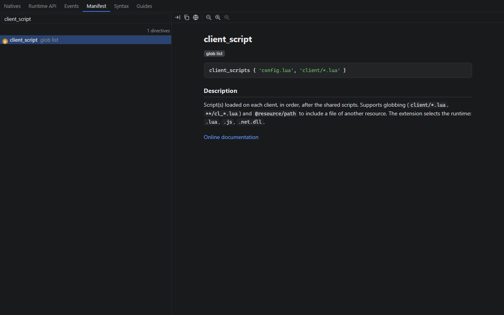
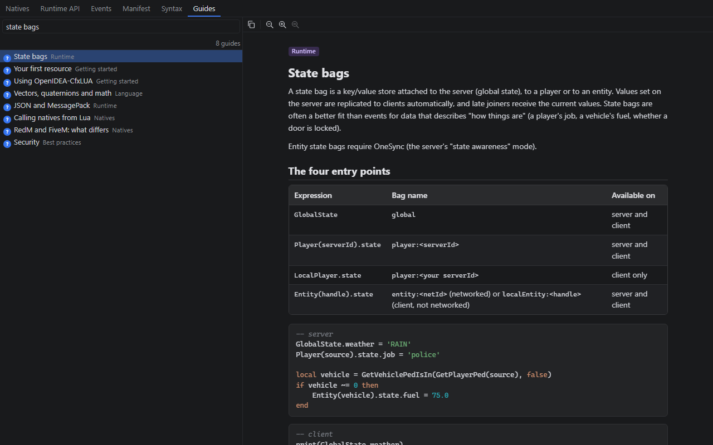

<h1 align="center">OpenIDEA-CfxLUA</h1>

<p align="center">
  <b>FiveM and RedM (CfxLua) support for <a href="https://github.com/l0ng-ai/openidea">OpenIDEA</a>.</b><br>
  Natives of the right game and side, client/server awareness, state bags, events, fxmanifest, NUI and built-in documentation.
</p>

<p align="center">
  <a href="https://github.com/SensityTech/OpenIDEA-CfxLUA/actions/workflows/ci.yml"></a>
  <a href="LICENSE"></a>
  <a href="https://github.com/l0ng-ai/openidea/tree/main/plugins"></a>
  
</p>

---

[OpenIDEA](https://github.com/l0ng-ai/openidea) is *the IDE you know, rebuilt in Rust*: the IntelliJ IDEA way of
working — keymap, tool windows, search everywhere — in a fast native app. It already reads Lua (tree-sitter
highlighting and [lua-language-server](https://luals.github.io/)). **OpenIDEA-CfxLUA** adds everything that only
a Cfx.re-aware tool knows: which natives exist for the game and the side a script runs on, the Cfx runtime API,
state bags, events, the resource manifest, the NUI bridge, the quirks of the CfxLua dialect and the documentation
to go with them.

It is an OpenIDEA plugin: a sandboxed WebAssembly component written in Rust that only reads your project through the
IDE, with the permissions you grant.

<p align="center">
  
</p>

## Contents

- [Features](#features)
- [Installation](#installation)
- [Getting started](#getting-started)
- [Commands](#commands)
- [Settings](#settings)
- [Permissions](#permissions)
- [Working with lua-language-server](#working-with-lua-language-server)
- [Known limitations](#known-limitations)
- [Building from source](#building-from-source)
- [Contributing](#contributing)
- [Credits and license](#credits-and-license)

## Features

### Client / server awareness

Every Lua file of a resource is classified as **client**, **server** or **shared**, the way FXServer does it:

1. the resource's `fxmanifest.lua` (`client_scripts`, `server_scripts`, `shared_scripts`, globs such as
   `client/*.lua` or `**/cl_*.lua`; the nearest manifest wins; a file listed on both sides is shared);
2. otherwise the file name (`client.lua`, `cl_*.lua`, `server.lua`, `sv_*.lua`, `shared.lua`, `sh_*.lua`);
3. otherwise the nearest folder inside the resource (`client/`, `cl/`, `server/`, `sv/`, `shared/`, `sh/`).

The side drives everything else: a client script is never offered server natives, a server script never client
ones. The status bar shows the focused file's side, resource and game (`Client script · shop · FiveM`) with the
reason in its tooltip, and file icons mark client, server and shared scripts and manifests in the project view.

### Natives, for the right game

- The **Cfx.re native databases** are bundled: GTA V and CFX natives for FiveM, RDR3 and CFX natives for RedM,
  FXServer natives for the server — with their real Lua names (`GetGroundZFor_3dCoord`, `N_0x…` for unnamed ones),
  typed parameters, **out-parameters returned the way Lua does it**
  (`local found, groundZ = GetGroundZFor_3dCoord(x, y, z, false)`), descriptions, Lua examples and links to the
  official reference.
- The game comes from the manifests (`game 'gta5'`, `games { 'rdr3' }`) or a setting: a FiveM project never sees
  RedM natives, and the other way round.
- Completion shows the signature and the full documentation of each native; old names (deprecated aliases) and
  unnamed natives are hidden unless you ask for them.
- A server native called from a client script (or the reverse) is reported.
- **CfxLua: Update Natives** (or the update button of the Natives tab) downloads the latest databases from Cfx.re
  (conditional requests: nothing is downloaded when nothing changed); a background check runs once a day. Offline,
  the bundled snapshot is used.

### Cfx runtime API

Documented completion for everything that is not a native: `Citizen.*`, `CreateThread` / `Wait` / `SetTimeout`,
events, `exports`, state bags (`GlobalState`, `Player(src).state`, `Entity(ent).state`, `LocalPlayer.state`),
`promise`, `json`, `msgpack`, vectors (`vector2/3/4`, `quat`), the CfxLua standard library extensions (`joaat`,
`table.wipe`, `string.strsplit`…), filtered by side like the natives.

### State bags

State bag keys written anywhere in the project (`Player(src).state:set('job', …)`, `GlobalState.weather = …`,
`Entity(ent).state.locked = …`) are indexed: `LocalPlayer.state.` completes `job` with where it is set, Go to
Definition jumps to the writes, and a typo such as `.state.jbo` is reported with a suggestion.

### Events

Handlers and triggers are matched across the project (`AddEventHandler`, `RegisterNetEvent`, `TriggerEvent`,
`TriggerServerEvent`, `TriggerClientEvent`, latent variants), with the built-in events (`onResourceStart`,
`playerConnecting`, `gameEventTriggered`…):

- event-name completion, filtered by the side that will receive the event;
- Go to Definition between triggers and handlers, gutter icons on both ends;
- checks for events that are triggered but never handled, network events that are not registered, and wrong sides.

### fxmanifest

- Completion of directives (with their documentation), values (`fx_version 'cerulean'`, `game 'gta5'`, every
  `data_file` type…), file paths and globs, `@other_resource/…` paths and dependencies; snippets for common blocks.
- Go to Definition on paths and globs (every matching file) and on dependencies.
- Checks with quick fixes: missing `fx_version` or `game`, missing or wrong `rdr3_warning`, deprecated `lua54`,
  misspelled directives, a single string given to a list directive, files that do not exist.
- **New** menu templates: `fxmanifest.lua` for FiveM and RedM, client script, server script, shared config.

### NUI bridge

Lua client scripts and the page (JavaScript, TypeScript, JSX/TSX, Vue, Svelte, HTML) are linked both ways:
`RegisterNUICallback('close')` ↔ `` fetch(`https://${GetParentResourceName()}/close`) `` and `fetchNui('close')`,
`SendNUIMessage({ action = 'open' })` ↔ `case 'open':` / `useNuiEvent('open')`. Completion of callback and message
names on both sides, Go to Definition and gutter icons between them, and checks: a callback the page calls but no
client script registers, a callback that does not answer on every path, a `ui_page` (or its build) missing from
`files`. An intention switches `ui_page` between the build and the dev server.

### CfxLua syntax checks

What the Cfx.re runtime accepts but reads differently, and what people type from other languages:

| You write | What happens | Reported |
|---|---|---|
| `i--` | starts a **comment** | warning, fix to `i -= 1` |
| `i++` / `++i` | syntax error | fix to `i += 1` |
| `x ^= 2` | bitwise **XOR**, not a power | fix to `x = x ^ (2)` |
| `c += 1` on a `<const>` local | silently ignored or corrupted | error |
| `local f <close> in t` | `<close>` ignored | warning |
| `!=`, `//=`, `%=`, `..=` | do not exist in CfxLua | fix to the valid form |

### Readable magic values

The numbers FiveM code is full of are named: `IsControlJustPressed(0, 38)` → `INPUT_PICKUP (E / LB)`,
`-1216765807` → `` `adder` ``, blip sprites and colours, marker types, HUD colours, explosion types, animation flags.
Values are completed with their names where a native expects them.

### Coordinates and performance

- Coordinate conversions between `vector3(…)`, tables, JSON and plain lists, and checks for suspicious coordinates.
- A performance linter for per-frame loops (`while true do … Wait(0)`), expensive natives called every frame,
  distance checks, repeated calls, with quick fixes and gutter markers showing the cost class of long-running loops.

### Asset Escrow

For resources sold through Cfx Asset Escrow: each file shows whether it will be encrypted or stay open according to
`escrow_ignore`, checks catch configuration and loaded files that buyers could not edit, encrypted (`FXAP`) files are
no longer parsed as Lua, and **CfxLua: Check Resource Before Escrow Upload** runs the pre-publish checklist.

### Built-in documentation

The **CfxLua** tool window (left side) has six tabs: a natives browser (search by name, `NATIVE_NAME`, hash or
camel humps such as `ggz`; FiveM / RedM / server filters; full sheet with native types, returns and example; insert
into the editor), the runtime API, the built-in events, the manifest directives, the CfxLua syntax features and
**guides** (getting started, natives, threads, events, exports, state bags, NUI, fxmanifest, vectors, json/msgpack,
commands, RedM vs FiveM, Asset Escrow, performance, security…).
**CfxLua: Show Documentation** shows the native, event, hash or directive at the caret.

| | |
|---|---|
|  |  |
| **Natives** — every parameter with its Lua and native type, returns, description and example. | **Events** — built-in events with their parameters, side, game and whether they can be cancelled. |
|  |  |
| **Runtime API** — `Citizen`, events, state bags, `json`, `msgpack`, vectors… | **Syntax** — what CfxLua adds to Lua 5.4, and its pitfalls. |
|  |  |
| **Manifest** — every `fxmanifest.lua` directive. | **Guides** — from your first resource to security and performance. |

The tool window follows the IDE theme ([light theme](assets/screenshots/tool-window-natives-light.png)).

## Installation

**Requirements — both are needed:**

| | |
|---|---|
| [OpenIDEA](https://github.com/l0ng-ai/openidea/releases/latest) 0.1.35 or newer | The IDE (plugin API 1.0). |
| [lua-language-server](https://luals.github.io/#install) on your `PATH` | OpenIDEA's Lua support: types of your own code, hover, signature help, references. OpenIDEA-CfxLUA feeds it the natives and the runtime API ([see below](#working-with-lua-language-server)). |

Install lua-language-server with `winget install LuaLS.lua-language-server`, `brew install lua-language-server`, your
distribution's package or a [release archive](https://github.com/LuaLS/lua-language-server/releases), then restart
OpenIDEA so that it finds it.

1. Download `sensity.cfxlua-<version>.oiplugin` from the
   [latest release](https://github.com/SensityTech/OpenIDEA-CfxLUA/releases/latest).
2. In OpenIDEA: **Settings › Plugins › Install Plugin from Package File…** and pick the file.
3. Review the [permissions](#permissions) and accept.

To install from the sources instead, [build it](#building-from-source) and use **Install Plugin from Disk…** on the
repository folder.

## Getting started

Open a folder that contains FiveM or RedM resources — a whole `server-data` folder works. The plugin indexes the
resources in the background (a task in the status bar) and is ready when it disappears. Then:

- open a client script: the status bar says `Client script · <resource> · FiveM`; type `GetEntity` to see natives
  with their documentation;
- type `AddEventHandler('` to list the events your scripts can receive;
- open the **CfxLua** tool window on the left for the natives browser and the guides (start with *Using
  OpenIDEA-CfxLUA*).

## Commands

Run them from **Find Action** (`Ctrl+Shift+A` / `Cmd+Shift+A`); bind keys in **Settings › Keymap**.

| Command | What it does |
|---|---|
| **CfxLua: Show Documentation** | Shows the native, event, hash literal or manifest directive at the caret in the tool window. Also on the status bar item. |
| **CfxLua: Update Natives** | Downloads the latest Cfx.re native databases now. |
| **CfxLua: Generate lua-language-server Definitions** | Fills the focused empty `.lua` file with the natives and the runtime API for lua-language-server ([how](#working-with-lua-language-server)). |
| **CfxLua: Check Resource Before Escrow Upload** | Runs the Asset Escrow pre-publish checklist on the resource of the focused file (Tools menu). |
| **CfxLua: Convert Coordinates** | Converts the selected coordinates to another format. |

## Settings

**Settings › Plugins › OpenIDEA-CfxLUA**; every value can be overridden per project.

| Setting | Default | |
|---|---|---|
| Enable FiveM / RedM support | on | Master switch. |
| Game | auto | `auto` reads the `game` / `games` directives of the manifests; or FiveM, RedM, both. |
| Client natives / Server natives / Cfx runtime API | on | Which parts are offered. |
| Show deprecated native aliases / unnamed natives in completion | off | Hidden ones are still recognised. |
| Show the Asset Escrow status of resource files | on | For resources declaring `escrow_ignore`. |
| Treat every resource as escrowed | off | Escrow checks everywhere. |

The NUI, events, values and performance checks have their own settings on the same page.

## Permissions

OpenIDEA plugins run in a sandbox and can only do what you grant when installing:

| Permission | Why |
|---|---|
| `project.read` | Read the resources (manifests, scripts, NUI pages) and show problems in them. |
| `editor.read`, `editor.write` | Commands and the tool window insert into the focused editor. |
| `storage` | Keep natives updates and tool window preferences. |
| `events` | Re-read saved files; update the status bar for the focused file. |
| `net:static.cfx.re`, `net:raw.githubusercontent.com` *(optional)* | Download natives updates (Cfx.re database, RDR3 NativeDB). Without them, the bundled natives are used. |
| `clipboard` *(optional)* | Copy buttons of the tool window. |

The plugin runs no programs and sends nothing anywhere except the natives update requests.

## Working with lua-language-server

OpenIDEA runs lua-language-server for Lua itself: the types of your own code and its `---@param` / `---@class`
annotations, hover, signature help, references. On its own it does not know CfxLua syntax or the natives, and reports
`+=`, backtick hashes and every native as errors. Two steps teach it:

1. **The configuration.** At the root of the project, **New › lua-language-server config (.luarc.json)**, named
   `.luarc`:

   ```json
   {
     "runtime.version": "Lua 5.4",
     "runtime.nonstandardSymbol": ["+=", "-=", "*=", "/=", "<<=", ">>=", "&=", "|=", "^=", "/**/", "`"],
     "workspace.library": [".cfxlua"],
     "workspace.ignoreDir": [".vscode", "node_modules", "fxmanifest.lua", "__resource.lua"],
     "diagnostics.ignoredFiles": "Disable"
   }
   ```

   It enables the CfxLua syntax, loads the `.cfxlua` folder as a library and leaves manifests to OpenIDEA-CfxLUA.
2. **The definitions.** Create an empty `.cfxlua/natives.lua`, keep it focused and run **CfxLua: Generate
   lua-language-server Definitions**, then save. The file receives every native of your games and of the
   server — documentation, parameters, returns, a signature per game — and the Cfx runtime API.

lua-language-server then checks calls to natives — a missing argument, a wrong type, one argument too many — and its
hover shows their documentation. Trailing flags may be left out, as the runtime allows. Run the command again after
**CfxLua: Update Natives** or a change of game; `.cfxlua/` can stay out of version control. See the
[lua-language-server settings](https://luals.github.io/wiki/settings/) for the rest.

## Known limitations

OpenIDEA's plugin API is a preview and does not offer everything yet. Where something is missing, the plugin uses
the closest equivalent:

| Not available to plugins | Instead |
|---|---|
| Hover / quick documentation popups | Documentation in completion, **CfxLua: Show Documentation**, the tool window |
| Inlay hints | Hint-level problems carrying the decoded value |
| Rename and Find Usages | Go to Definition lists every match |
| Creating files (New Resource) | One **New** template per file |
| Opening links from the tool window | URLs are shown with a copy button |

## Building from source

You need Rust (stable) with the `wasm32-wasip2` target.

```sh
rustup target add wasm32-wasip2
cargo test --lib                 # unit tests, against the SDK's mock host
scripts/build.sh --pack          # dist/plugin.wasm and dist/sensity.cfxlua-<version>.oiplugin
```

On Windows, `scripts\build.ps1 -Pack` does the same, and `scripts\build.ps1 -Link` links the repository folder into
OpenIDEA for development (then **Settings › Plugins › Reload** after each build).

The plugin is built with the [OpenIDEA plugin SDK](https://github.com/l0ng-ai/openidea/tree/main/sdk/rust/openidea-plugin)
(see the [plugin documentation](https://github.com/l0ng-ai/openidea/tree/main/plugins)).

## Contributing

Bug reports, ideas and pull requests are welcome: see [CONTRIBUTING.md](CONTRIBUTING.md). Please report security
issues privately as described in [SECURITY.md](SECURITY.md).

## Credits and license

Licensed under the [Apache License 2.0](LICENSE); attributions are in [NOTICE](NOTICE).

- Natives: the [Cfx.re native database](https://docs.fivem.net/natives/) and
  [alloc8or/rdr3-nativedb-data](https://github.com/alloc8or/rdr3-nativedb-data).
- Hash names: [calamity-inc/gta-v-joaat-hash-db](https://github.com/calamity-inc/gta-v-joaat-hash-db).
- Built on [OpenIDEA](https://github.com/l0ng-ai/openidea) and its plugin SDK.

<sub>FiveM, RedM and Cfx.re are trademarks of their respective owners. This project is not affiliated with or
endorsed by Cfx.re, Rockstar Games or Take-Two Interactive.</sub>
