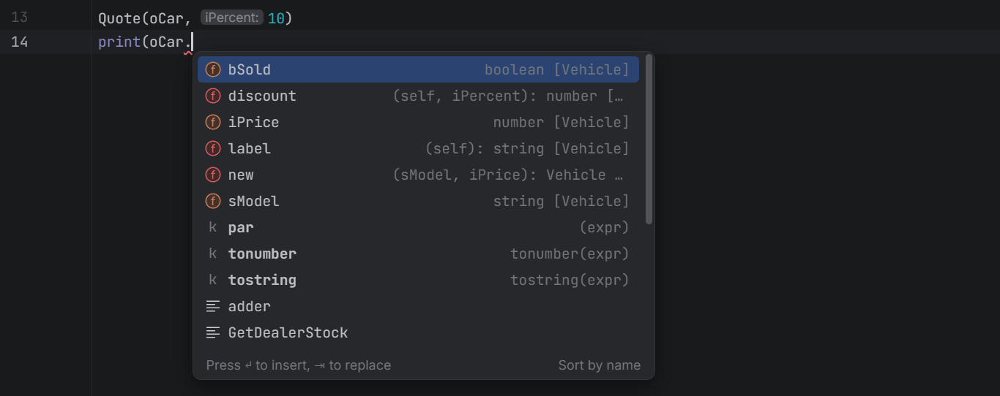
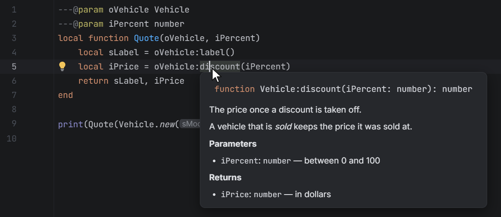
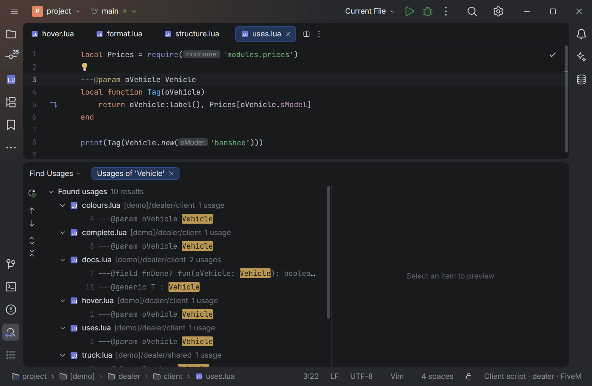
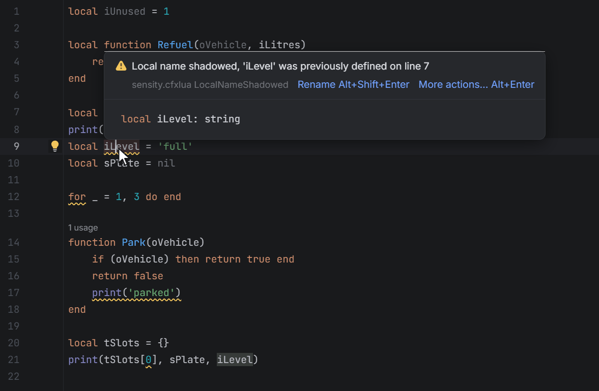
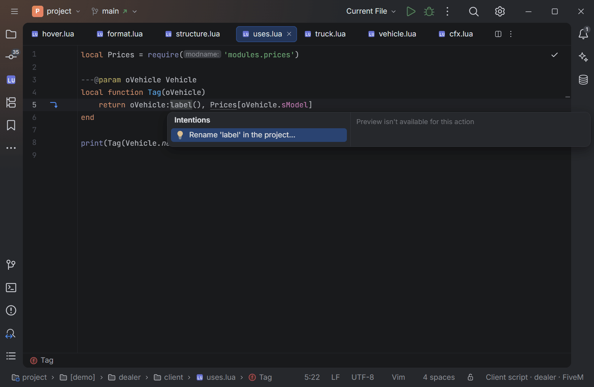
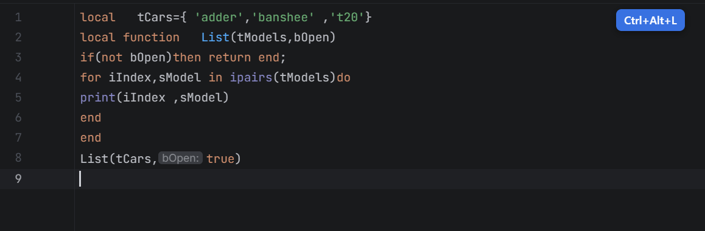
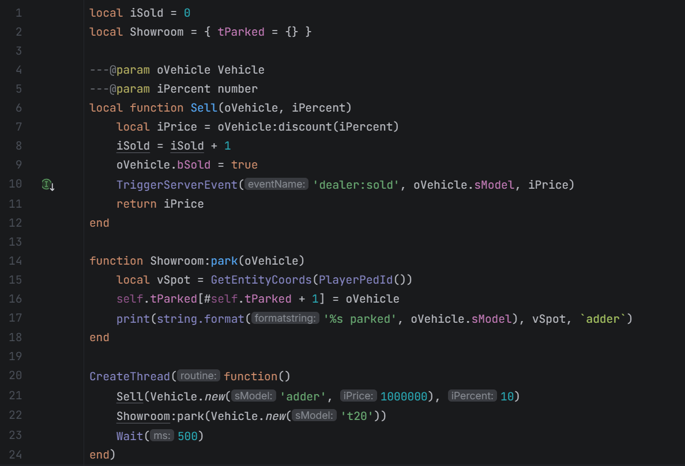
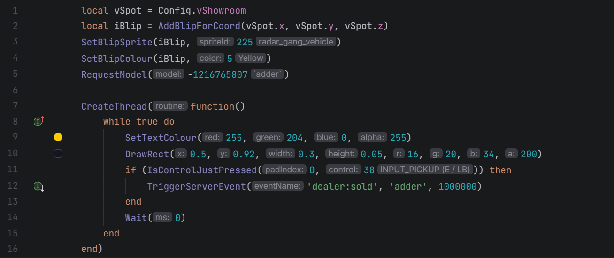
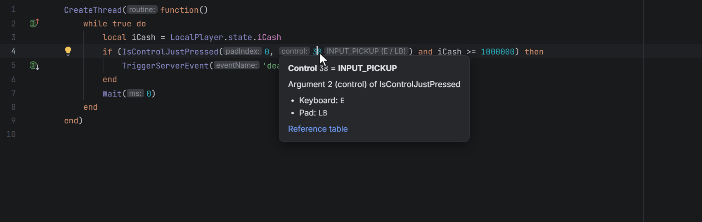
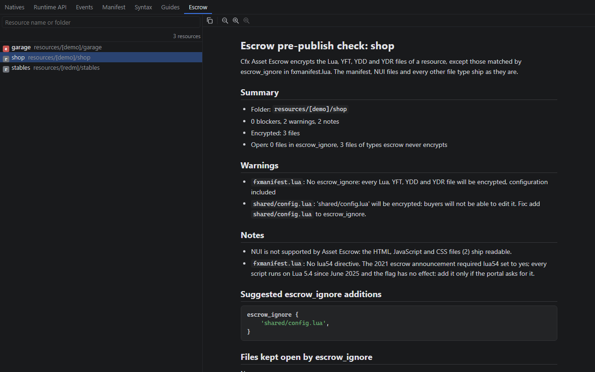

<h1 align="center">OpenIDEA-CfxLUA</h1>

<p align="center">
  <b>FiveM and RedM (CfxLua) support for <a href="https://github.com/l0ng-ai/openidea">OpenIDEA</a>.</b><br>
  A Lua engine of its own (completion, documentation, inspections, refactorings, a formatter) and what only a Cfx.re-aware tool knows:<br>
  natives of the right game and side, client/server awareness, state bags, events, fxmanifest, NUI and built-in documentation.
</p>

<p align="center">
  <a href="https://github.com/SensityTech/OpenIDEA-CfxLUA/actions/workflows/ci.yml"></a>
  <a href="LICENSE"></a>
  <a href="https://github.com/l0ng-ai/openidea/tree/main/plugins"></a>
  
</p>

---

[OpenIDEA](https://github.com/l0ng-ai/openidea) is *the IDE you know, rebuilt in Rust*: the IntelliJ IDEA way of
working — keymap, tool windows, search everywhere — in a fast native app. **OpenIDEA-CfxLUA** makes it an IDE for
FiveM and RedM. It reads CfxLua with a parser and a type engine of its own, ported from the JetBrains plugin the
project comes from: completion, documentation, navigation, inspections, intentions, refactorings and a formatter,
without a language server. And it adds everything that only a Cfx.re-aware tool knows: which natives exist for the
game and the side a script runs on, the Cfx runtime API, state bags, events, the resource manifest, the NUI
bridge, the quirks of the CfxLua dialect and the documentation to go with them.

It is an OpenIDEA plugin: a sandboxed WebAssembly component written in Rust that only reads your project through the
IDE, with the permissions you grant.

<p align="center">
  
</p>

## Contents

- [Features](#features)
- [Installation](#installation)
- [Getting started](#getting-started)
- [Commands](#commands)
- [Settings](#settings)
- [Permissions](#permissions)
- [Working with lua-language-server](#working-with-lua-language-server)
- [Running FXServer](#running-fxserver)
- [Known limitations](#known-limitations)
- [Building from source](#building-from-source)
- [Contributing](#contributing)
- [Credits and license](#credits-and-license)

## Features

### Lua, without a language server

The plugin has its own CfxLua parser and its own type engine, a port to Rust of
[IntelliJ-EmmyLua](https://github.com/EmmyLua/IntelliJ-EmmyLua) as Sensity DevKit, its fork for CfxLua, extends it.
`---@class`, `---@field`, `---@param`, `---@return`, `---@type`, `---@alias`, `---@generic`, `---@overload` and
`---@enum` give the types (EmmyDoc and the LuaCATS annotations of lua-language-server are both read); what is not
annotated is inferred.

- **Completion** of the members of a table, a class or an object after `.` and `:`, of the names in sight (locals
  first, with their types), of what a place asks for (the strings of a literal type, the fields of the class a
  table is expected to be), of the methods of the parent classes to define again, of `require` paths, and inside
  documentation comments; postfix templates (`count.if`) and live templates (`fori`).

  

- **Documentation**: hover, parameter info and inlay hints (the names of parameters; the types of locals, of
  parameters and of what functions return once turned on), for your code, the Lua standard library, the Cfx
  runtime and the natives.

  

- **Navigation**: Go to Declaration and Go to Type Declaration, Find Usages of classes, globals, table members,
  events and state bag keys, the Structure view, folding, the uses of the name under the caret, and gutter
  markers on methods that override another one, on classes that have subclasses, on recursive and tail calls.

  

- **Inspections** with their quick fixes: unused locals and parameters, a local that hides another, empty bodies,
  unreachable statements, a table indexed at 0, a class declared twice, the use of what is deprecated, a type
  nothing declares; type safety (arguments, return values, assignments, undeclared names) and *Global name can be
  local* once turned on in the settings. A `---@suppress` comment turns one off for a statement.

  

- **Intentions** (Alt+Enter): write `---@param`, `---@type`, `---@return` or a whole documentation comment with
  the types the plugin infers, invert a boolean, compute an operation between constants, add or remove the
  parentheses of a call, surround statements with a region.
- **Refactorings**: rename a local; rename a global or a member across the project, the type engine telling what
  each use stands for, with the methods that override it; rename or move a Lua file with the `require`s that load
  it and the manifest that names it; convert a legacy `__resource.lua` to `fxmanifest.lua`.

  

- **A formatter**, the one of the JetBrains plugin, once the plugin is chosen for `lua` in **Settings › Languages
  & Frameworks › Plugin Formatters**: Reformat Code (a file or a selection) and Format on save.

  

- **In the editor**: semantic colours, coloured documentation comments, the syntax errors of CfxLua, Extend
  Selection.

  

Every feature has its picture in the [changelog of 1.0.0](CHANGELOG.md#100---2026-11-13).

### Client / server awareness

Every Lua file of a resource is classified as **client**, **server** or **shared**, the way FXServer does it:

1. the resource's `fxmanifest.lua` (`client_scripts`, `server_scripts`, `shared_scripts`, globs such as
   `client/*.lua` or `**/cl_*.lua`; the nearest manifest wins; a file listed on both sides is shared);
2. otherwise the file name (`client.lua`, `cl_*.lua`, `server.lua`, `sv_*.lua`, `shared.lua`, `sh_*.lua`);
3. otherwise the nearest folder inside the resource (`client/`, `cl/`, `server/`, `sv/`, `shared/`, `sh/`).

The side drives everything else: a client script is never offered server natives, a server script never client
ones. The status bar shows the focused file's side, resource and game (`Client script · shop · FiveM`) with the
reason in its tooltip, and file icons mark client, server and shared scripts and manifests in the project view.

### Natives, for the right game

- The **Cfx.re native databases** are bundled: GTA V and CFX natives for FiveM, RDR3 and CFX natives for RedM,
  FXServer natives for the server — with their real Lua names (`GetGroundZFor_3dCoord`, `N_0x…` for unnamed ones),
  typed parameters, **out-parameters returned the way Lua does it**
  (`local found, groundZ = GetGroundZFor_3dCoord(x, y, z, false)`), descriptions, Lua examples and links to the
  official reference.
- The game comes from the manifests (`game 'gta5'`, `games { 'rdr3' }`) or a setting: a FiveM project never sees
  RedM natives, and the other way round.
- Completion shows the signature and the full documentation of each native; old names (deprecated aliases) and
  unnamed natives are hidden unless you ask for them.
- A server native called from a client script (or the reverse) is reported.
- **CfxLua: Update Natives** (or the update button of the Natives tab) downloads the latest databases from Cfx.re
  (conditional requests: nothing is downloaded when nothing changed); a background check runs once a day. Offline,
  the bundled snapshot is used; it is refreshed every week, so each release ships recent natives.

### Cfx runtime API

Documented completion for everything that is not a native: `Citizen.*`, `CreateThread` / `Wait` / `SetTimeout`,
events, `exports`, state bags (`GlobalState`, `Player(src).state`, `Entity(ent).state`, `LocalPlayer.state`),
`promise`, `json`, `msgpack`, vectors (`vector2/3/4`, `quat`), the CfxLua standard library extensions (`joaat`,
`table.wipe`, `string.strsplit`…), filtered by side like the natives.

### State bags

State bag keys written anywhere in the project (`Player(src).state:set('job', …)`, `GlobalState.weather = …`,
`Entity(ent).state.locked = …`) are indexed: `LocalPlayer.state.` completes `job` with where it is set, Go to
Definition jumps to the writes, and a typo such as `.state.jbo` is reported with a suggestion.

### Events

Handlers and triggers are matched across the project (`AddEventHandler`, `RegisterNetEvent`, `TriggerEvent`,
`TriggerServerEvent`, `TriggerClientEvent`, latent variants), with the built-in events (`onResourceStart`,
`playerConnecting`, `gameEventTriggered`…):

- event-name completion, filtered by the side that will receive the event;
- Go to Definition between triggers and handlers, gutter icons on both ends;
- checks for events that are triggered but never handled, network events that are not registered, and wrong sides.

### fxmanifest

- Completion of directives (with their documentation), values (`fx_version 'cerulean'`, `game 'gta5'`, every
  `data_file` type…), file paths and globs, `@other_resource/…` paths and dependencies; snippets for common blocks.
- Go to Definition on paths and globs (every matching file) and on dependencies.
- Checks with quick fixes: missing `fx_version` or `game`, missing or wrong `rdr3_warning`, deprecated `lua54`,
  misspelled directives, a single string given to a list directive, files that do not exist.
- **New** menu templates: `fxmanifest.lua` for FiveM and RedM, client script, server script, shared config.

### NUI bridge

Lua client scripts and the page (JavaScript, TypeScript, JSX/TSX, Vue, Svelte, HTML) are linked both ways:
`RegisterNUICallback('close')` ↔ `` fetch(`https://${GetParentResourceName()}/close`) `` and `fetchNui('close')`,
`SendNUIMessage({ action = 'open' })` ↔ `case 'open':` / `useNuiEvent('open')`. Completion of callback and message
names on both sides, Go to Definition and gutter icons between them, and checks: a callback the page calls but no
client script registers, a callback that does not answer on every path, a `ui_page` (or its build) missing from
`files`. An intention switches `ui_page` between the build and the dev server.

### CfxLua syntax checks

What the Cfx.re runtime accepts but reads differently, and what people type from other languages:

| You write | What happens | Reported |
|---|---|---|
| `i--` | starts a **comment** | warning, fix to `i -= 1` |
| `i++` / `++i` | syntax error | fix to `i += 1` |
| `x ^= 2` | bitwise **XOR**, not a power | fix to `x = x ^ (2)` |
| `c += 1` on a `<const>` local | silently ignored or corrupted | error |
| `local f <close> in t` | `<close>` ignored | warning |
| `!=`, `//=`, `%=`, `..=` | do not exist in CfxLua | fix to the valid form |

### Readable magic values

The numbers FiveM code is full of are named, in an inlay hint after the number: `IsControlJustPressed(0, 38)` →
`INPUT_PICKUP (E / LB)`, `-1216765807` → `` `adder` ``, blip sprites and colours, marker types, HUD colours,
explosion types, animation flags. Values are completed with their names where a native expects them.



Hovering such a number, a hash literal, an event name or a state bag key shows what it stands for: the keys of a
control, the values of a hash, who triggers and who handles an event, where a state bag key is set and read.



A colour written as red, green and blue components in a drawing call has a swatch in the gutter: picking another
colour rewrites the components.

### Coordinates and performance

- Coordinate conversions between `vector3(…)`, tables, JSON and plain lists, and checks for suspicious coordinates.
- A performance linter for per-frame loops (`while true do … Wait(0)`), expensive natives called every frame,
  distance checks, repeated calls, with quick fixes and gutter markers showing the cost class of long-running loops.

### Asset Escrow

For resources sold through Cfx Asset Escrow: each file shows whether it will be encrypted or stay open according to
`escrow_ignore`, checks catch configuration and loaded files that buyers could not edit, encrypted (`FXAP`) files are
no longer parsed as Lua, and **CfxLua: Check Resource Before Escrow Upload** runs the pre-publish checklist and
opens its full report — blockers, warnings, suggested `escrow_ignore` patterns, the files kept open, the files
encrypted and the size of the resource (more than 1 GB is a blocker) — in the **Escrow** tab of the tool window,
which lists every resource of the project.

### Built-in documentation

The **CfxLua** tool window (left side) has seven tabs: a natives browser (search by name, `NATIVE_NAME`, hash or
camel humps such as `ggz`; FiveM / RedM / server filters; full sheet with native types, returns and example; insert
into the editor), the runtime API, the built-in events, the manifest directives, the CfxLua syntax features,
**guides** (getting started, natives, threads, events, exports, state bags, NUI, fxmanifest, vectors, json/msgpack,
commands, RedM vs FiveM, Asset Escrow, performance, security…) and the **Asset Escrow** report of each resource.
**CfxLua: Show Documentation** shows the native, event, hash or directive at the caret.

| | |
|---|---|
|  |  |
| **Natives** — every parameter with its Lua and native type, returns, description and example. | **Events** — built-in events with their parameters, side, game and whether they can be cancelled. |
|  |  |
| **Runtime API** — `Citizen`, events, state bags, `json`, `msgpack`, vectors… | **Syntax** — what CfxLua adds to Lua 5.4, and its pitfalls. |
|  |  |
| **Manifest** — every `fxmanifest.lua` directive. | **Guides** — from your first resource to security and performance. |
|  | |
| **Escrow** — the pre-publish report of each resource, with the patterns to add to `escrow_ignore`. | |

The tool window follows the IDE theme ([light theme](assets/screenshots/tool-window-natives-light.png)).

## Installation

**Requirement:** [OpenIDEA](https://github.com/l0ng-ai/openidea/releases/latest) 0.1.40 or newer (plugin API 1.4).

[lua-language-server](https://luals.github.io/) is no longer needed: since 1.0.0 the plugin has its own Lua engine.
One thing to do either way, depending on whether OpenIDEA runs lua-language-server for your Lua files:

- **Without it**, OpenIDEA 0.1.40 reports with its own parser what it cannot read, and that parser does not know
  CfxLua: `+=`, a set constructor or a C comment get an *Unexpected token*. Turn **Syntax errors** off in
  **Settings › Editor › Inspections** (group *General*): the plugin reports the syntax errors of CfxLua itself.
- **With it**, OpenIDEA lists its completion entries and its problems next to the plugin's without merging them:
  what both know comes twice. To keep the plugin alone, turn lua-language-server off in **Settings › Languages &
  Frameworks › Language Servers**; to keep both, see
  [Working with lua-language-server](#working-with-lua-language-server).

### From a package file

1. Download `sensity.cfxlua-<version>.oiplugin` from the
   [latest release](https://github.com/SensityTech/OpenIDEA-CfxLUA/releases/latest).
2. In OpenIDEA: **Settings › Plugins › Install Plugin from Package File…** and pick the file.
3. Review the [permissions](#permissions) and accept.

To install from the sources instead, [build it](#building-from-source) and use **Install Plugin from Disk…** on the
repository folder.

### From the OpenIDEA-CfxLUA marketplace

Every release is also published in the project's own marketplace, signed by its publisher, `sensity`. In
**Settings › Plugins**, open the gear menu › **Plugin Repository…** and set the marketplace index URL to

```text
https://github.com/SensityTech/OpenIDEA-CfxLUA/releases/download/marketplace/index.json
```

then, in **Available**, select **OpenIDEA-CfxLUA** and **Install**. OpenIDEA checks the download against the index and
the publisher's key, shows *Signed by sensity* and offers each new version as an update.

OpenIDEA reads one marketplace at a time and trusts the publishers it lists: while this one is set, a package signed
by another publisher is refused. Leave the URL empty to go back to OpenIDEA's default marketplace. For the same
reason, the package file of a release is not signed: OpenIDEA's default marketplace does not list `sensity`.

## Getting started

Open a folder that contains FiveM or RedM resources — a whole `server-data` folder works. The plugin indexes the
resources in the background, the resource you open first; in a big project it goes on while you work, and events,
NUI callbacks and state bags of the whole project fill in within the first minutes (natives are there at once).
Then:

- open a client script: the status bar says `Client script · <resource> · FiveM`; type `GetEntity` to see natives
  with their documentation;
- type `AddEventHandler('` to list the events your scripts can receive;
- open the **CfxLua** tool window on the left for the natives browser and the guides (start with *Using
  OpenIDEA-CfxLUA*).

## Commands

Run them from **Find Action** (`Ctrl+Shift+A` / `Cmd+Shift+A`); bind keys in **Settings › Keymap**.

| Command | What it does |
|---|---|
| **CfxLua: Show Documentation** | Shows the native, event, hash literal or manifest directive at the caret in the tool window. Also on the status bar item. |
| **CfxLua: Update Natives** | Downloads the latest Cfx.re native databases now. |
| **CfxLua: Generate lua-language-server Definitions** | Fills the focused empty `.lua` file with the natives and the runtime API for lua-language-server ([how](#working-with-lua-language-server)). |
| **CfxLua: Check Resource Before Escrow Upload** | Runs the Asset Escrow pre-publish checklist on the resource of the focused file and opens its report in the Escrow tab (Tools menu). |
| **CfxLua: Convert Coordinates** | Converts the selected coordinates to another format. |

## Settings

**Settings › Plugins › OpenIDEA-CfxLUA**; every value can be overridden per project.

| Setting | Default | |
|---|---|---|
| Enable FiveM / RedM support | on | Master switch. |
| Game | auto | `auto` reads the `game` / `games` directives of the manifests; or FiveM, RedM, both. |
| Client natives / Server natives / Cfx runtime API | on | Which parts are offered. |
| Show deprecated native aliases / unnamed natives in completion | off | Hidden ones are still recognised. |
| Show the Asset Escrow status of resource files | on | For resources declaring `escrow_ignore`. |
| Treat every resource as escrowed | off | Escrow checks everywhere. |

The inlay hints (parameter names are on, types are off), the inspections (type safety and *Global name can be
local* are off), the gutter markers, the options of the formatter, and the NUI, events, values and performance
checks have their own settings on the same page.

## Permissions

OpenIDEA plugins run in a sandbox and can only do what you grant when installing:

| Permission | Why |
|---|---|
| `project.read` | Read the resources (manifests, scripts, NUI pages) and show problems in them. |
| `editor.read`, `editor.write` | Commands and the tool window insert into the focused editor. |
| `storage` | Keep natives updates and tool window preferences. |
| `events` | Re-read saved files; update the status bar for the focused file. |
| `net:static.cfx.re`, `net:raw.githubusercontent.com` *(optional)* | Download natives updates (Cfx.re database, RDR3 NativeDB). Without them, the bundled natives are used. |
| `clipboard` *(optional)* | Copy buttons of the tool window. |
| `process:FXServer` *(optional)* | The **FXServer (server.cfg)** run configuration ([Running FXServer](#running-fxserver)). |

The plugin sends nothing anywhere except the natives update requests, and runs no program except FXServer when you
start that run configuration.

## Working with lua-language-server

The plugin does not need lua-language-server, but OpenIDEA runs it for Lua files when it is installed. On its own
it does not know CfxLua syntax or the natives, and reports `+=`, backtick hashes and every native as errors. Two
steps teach it:

1. **The configuration.** At the root of the project, **New › lua-language-server config (.luarc.json)**, named
   `.luarc`:

   ```json
   {
     "runtime.version": "Lua 5.4",
     "runtime.nonstandardSymbol": ["+=", "-=", "*=", "/=", "<<=", ">>=", "&=", "|=", "^=", "/**/", "`"],
     "workspace.library": [".cfxlua"],
     "workspace.ignoreDir": [".vscode", "node_modules", "fxmanifest.lua", "__resource.lua", ".cfxlua"],
     "diagnostics.ignoredFiles": "Disable",
     "completion.maxSuggestCount": 1000
   }
   ```

   It enables the CfxLua syntax, loads the `.cfxlua` folder as a library without checking it as project code, leaves
   manifests to OpenIDEA-CfxLUA and lets completion list every native matching what you type (lua-language-server
   stops at 100 by default, which can hide the one you want).
2. **The definitions.** Create an empty `.cfxlua/natives.lua`, keep it focused and run **CfxLua: Generate
   lua-language-server Definitions**, then save. The file receives every native of your games and of the
   server — documentation, parameters, returns, a signature per game — and the Cfx runtime API.

lua-language-server then checks calls to natives — a missing argument, a wrong type, one argument too many — and its
hover shows their documentation. Trailing flags may be left out, as the runtime allows. A native of several games has
one signature: parameters some games lack are optional. Run the command again after **CfxLua: Update Natives** or a
change of game; `.cfxlua/` can stay out of version control. See the
[lua-language-server settings](https://luals.github.io/wiki/settings/) for the rest.

Once lua-language-server loads the file, it is the one that completes those natives and the Cfx runtime API (one
entry each), goes to their declaration and colors them as library functions: OpenIDEA-CfxLUA stops listing them
itself, which would show each one twice. It still completes the natives of a game the file lacks, and still reports a
client native called from a server script, and the reverse.

## Running FXServer

When the project is a `server-data` folder (a `server.cfg` at its root), the run configurations list
**FXServer (server.cfg)**: it starts `FXServer +exec server.cfg` in the project root, with its console in the Run tool
window. It needs the optional `process:FXServer` permission, granted on the install page or later in
**Settings › Plugins**; OpenIDEA then looks the program up on your `PATH`:

- **Windows:** add the folder of `FXServer.exe` (your server artifacts) to `PATH`.
- **Linux:** put an executable `FXServer` script on your `PATH` that runs the artifacts' `run.sh`, for example
  `exec /opt/fxserver/run.sh "$@"`.

Set `PATH` before granting the permission (restart OpenIDEA if it does not see the change). The permission pins the
program it found: after an artifacts update, approve it again in **Settings › Plugins**.

## Known limitations

| Not done yet | Instead |
|---|---|
| Find Usages of a member reached through a value (`shop:open()` where `shop` is a value of the class) | Find Usages lists the occurrences of the word; **Rename '…' in the project** tells them apart with the type engine |
| Hover on the directives of a manifest | Documentation in completion, **CfxLua: Show Documentation**, the tool window |
| Rename and Find Usages of NUI callbacks and messages | Go to Definition lists every match |
| Creating files (New Resource) | One **New** template per file |
| Opening the tool window from a command | **CfxLua: Show Documentation** shows the entry in the tool window and sums it up in a notification |
| A plugin icon in **Settings › Plugins** | The generic plugin icon |

OpenIDEA does not offer these to plugins:

| Not available to plugins | Instead |
|---|---|
| File icons by side (a plugin's file icons match file names only) | `client.lua`, `cl_*.lua`, `*_client.lua`… (and the server and shared equivalents) get the side icons; a `client/main.lua` keeps the Lua icon, and the status bar shows its side |
| Merging a plugin's completion and problems with lua-language-server's | Once lua-language-server loads the generated definitions, their natives and runtime API are left to it; for the rest, see [Installation](#installation) |
| Silencing OpenIDEA's own *Syntax errors* inspection, which does not know CfxLua | Turn it off in **Settings › Editor › Inspections** when no language server runs for Lua |
| Telling a plugin that a file was renamed or moved from the project tree | **Rename file and its requires…** and **Move file and its requires…**, Alt+Enter on the first line of the file |
| More than 200,000 names of a project for Find Usages | A project of more than 600 Lua files gives its classes and its globals, one of more than 1,200 its classes only; Find Usages lists the occurrences of the word for the rest |
| The colours of another language in a string (`---@language SQL`) | OpenIDEA 0.1.40 reads such a string as SQL but draws it in the colour of a Lua string |

## Building from source

You need Rust (stable) with the `wasm32-wasip2` target.

```sh
rustup target add wasm32-wasip2
cargo test --lib                 # unit tests, against the SDK's mock host
scripts/build.sh --pack          # dist/plugin.wasm and dist/sensity.cfxlua-<version>.oiplugin
```

On Windows, `scripts\build.ps1 -Pack` does the same, and `scripts\build.ps1 -Link` links the repository folder into
OpenIDEA for development (then **Settings › Plugins › Reload** after each build). The link is written for the installed
OpenIDEA: `pnpm tauri dev` builds keep their data, linked folders included, apart.

The plugin is built with the [OpenIDEA plugin SDK](https://github.com/l0ng-ai/openidea/tree/main/sdk/rust/openidea-plugin)
(see the [plugin documentation](https://github.com/l0ng-ai/openidea/tree/main/plugins)).

## Contributing

Bug reports, ideas and pull requests are welcome: see [CONTRIBUTING.md](CONTRIBUTING.md). Please report security
issues privately as described in [SECURITY.md](SECURITY.md).

## Credits and license

Licensed under the [Apache License 2.0](LICENSE); attributions are in [NOTICE](NOTICE).

- Type engine and formatter: ports to Rust of [IntelliJ-EmmyLua](https://github.com/EmmyLua/IntelliJ-EmmyLua),
  through Sensity DevKit, its fork for CfxLua; the stubs of the Lua standard library come from it.
- Natives: the [Cfx.re native database](https://docs.fivem.net/natives/) and
  [alloc8or/rdr3-nativedb-data](https://github.com/alloc8or/rdr3-nativedb-data).
- Hash names: [calamity-inc/gta-v-joaat-hash-db](https://github.com/calamity-inc/gta-v-joaat-hash-db).
- Built on [OpenIDEA](https://github.com/l0ng-ai/openidea) and its plugin SDK.

<sub>FiveM, RedM and Cfx.re are trademarks of their respective owners. This project is not affiliated with or
endorsed by Cfx.re, Rockstar Games or Take-Two Interactive.</sub>
